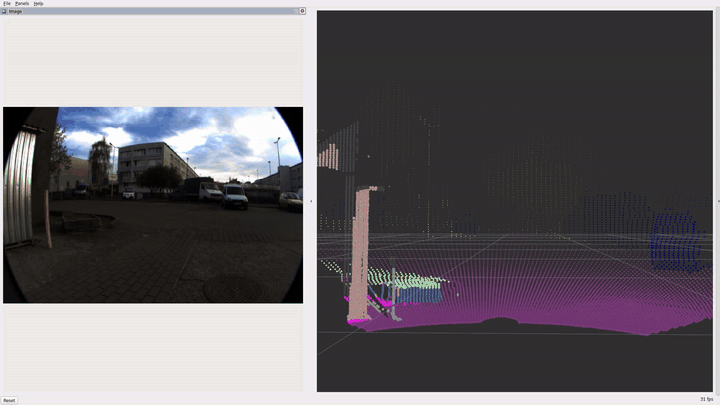
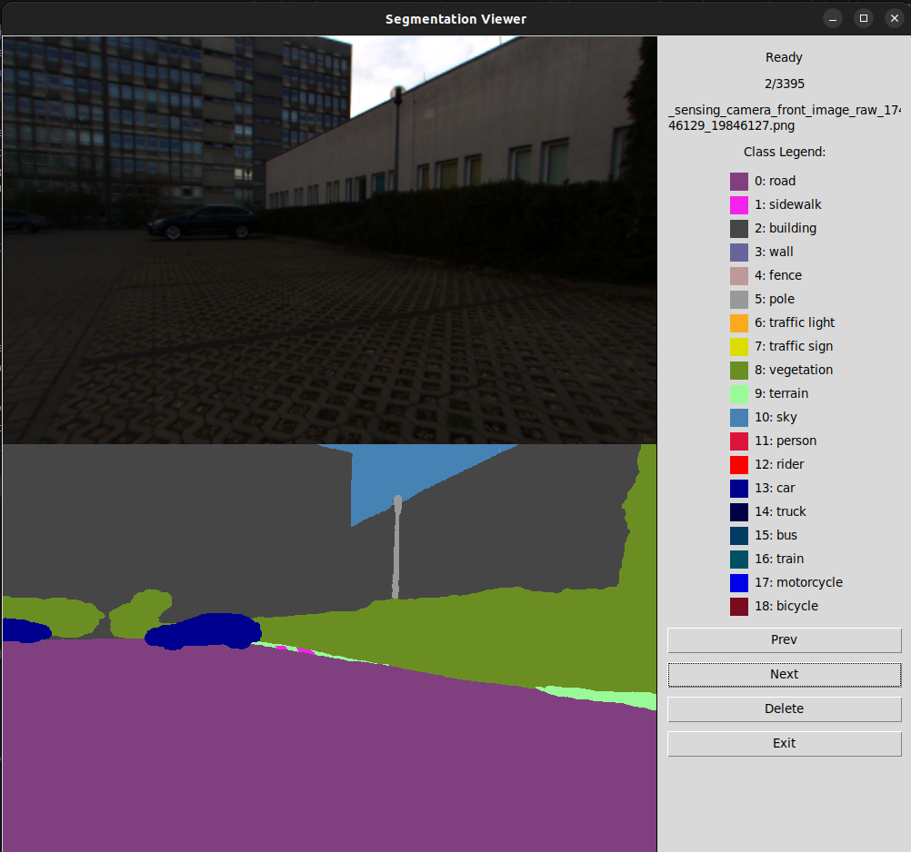

# Semantic mapping for Autonomous Vehicles


- [Semantic mapping for Autonomous Vehicles](#semantic-mapping-for-autonomous-vehicles)
  - [The Docker container](#the-docker-container)
  - [ROS2 Node for mapping with semantic information](#ros2-node-for-mapping-with-semantic-information)
    - [Class filtering](#class-filtering)
  - [Segmentation models](#segmentation-models)
  - [Class Definitions](#class-definitions)
  - [Segmentation models visualisations](#segmentation-models-visualisations)
  - [Inference performance](#inference-performance)
  - [Segmentation Annotation Viewer](#segmentation-annotation-viewer)
  - [Wandb Training Logs](#wandb-training-logs)
  - [Tools](#tools)
    - [Get images from rosbags](#get-images-from-rosbags)
    - [Annotate the data with GroundingDINO and SAM2](#annotate-the-data-with-groundingdino-and-sam2)


An example of an Octomap created with the additional semantic information. The recording was sped up 10x to show the complete mapping process.

## The Docker container

To build the docker image (requires around 12.6 GB of space), clone the repository, and once you're inside the directory, use the following command:

```
docker build -t semantic-mapping .
```

You can start the container by running:

```
bash start_container.sh
```

> [!NOTE]
> You can adjust the paths to the directory with rosbags and with segmentation model inside the bash script.

> [!WARNING]
> By default the docker container is removed after being closed and all data is lost. To avoid that you can remove `--rm` flag, save the data inside shared folders or copy the data from the container to your computer.

## ROS2 Node for mapping with semantic information


An additional semantic information can be valuable in multiple robotic tasks, particularly in navigation and path planning. For example, it enables intelligent path cost assignment based on terrain type (allowing robots to favor asphalt over slippery or muddy surfaces for safer, faster travel), and distinguishing between static and dynamic obstacles, a knowledge that is useful in planning avoidance strategies.

To start the ROS2 node that runs segmentation on images from a camera and adjusts color of a pointcloud from LIDAR/depth camera based on the segmentation mask, you can run:

```
ros2 launch segmentation_node segmentation_node_launch.py
```

> [!NOTE]
> You can check all available adjustable parameters (topic names, frame ids, not using Octomap, changing number of threads, etc.) by running `ros2 launch segmentation_node segmentation_node_launch.py --show-args`.



The ROS2 node implements a synchronized processing pipeline for semantic mapping. It begins by subscribing to RGB camera images and point cloud data from topics specified as parameters. These images go through preprocessing, including resolution adjustment and normalization using ImageNet weights, before being passed to an ONNX-format segmentation model for inference. Using transformation between the camera and LiDAR frames (obtained from the `/tf` topic), the each 3D point is projected onto the segmentation mask and assigns appropriate semantic colors based on the predicted labels. The resulting point cloud is then published to another topic, where the OctoMap server can subscribe to it and construct a semantic 3D map of the environment.

The launch file starts the segmentation node, Octomap server and RVIZ for visualition. By default Octomap is not visible in RVIZ due to long time required to update the visualization (the map itself runs fine), but you can enable it at any time. Using default settings, the time required to process a pointcloud with corresponding rgb image is on average around 50 ms (20 fps) on computer with AMD Ryzen 5 5600X, 32GB of RAM and NVidia RTX 4070. Running single-threaded slowed down processing to around 10 fps, while running on all 12 threads led to 25-30 fps.

### Class filtering

The segmentation node allows to remove points belonging to selected classes. Users can configure which classes are visible by adjusting the `classes_with_colors` parameter in JSON format, where the boolean value (`true` or `false`) determines whether points from that class are included in the final point cloud visualization. This can be useful to create a general map of the environment, where all movable objects are removed (e.g. cars/people from a road or parking lot). The other usage can be creation of a 3D model of a specific object that is a target of a robot (e.g. a cup on a desk).


## Segmentation models

## Class Definitions
| ID | Category | Color | RGB |
|:---|:---|:---|:---|
| 0 | Other |  | (0, 0, 0) |
| 1 | Sky |  | (70, 130, 180) |
| 2 | Building |  | (70, 70, 70) |
| 3 | Grass |  | (152, 251, 152) |
| 4 | Road |  | (128, 64, 128) |
| 5 | Tree |  | (107, 142, 35) |
| 6 | Traffic objects |  | (220, 220, 0) |
| 7 | Car |  | (0, 0, 142) |
| 8 | Person |  | (255, 0, 0) |

## Segmentation models visualisations

| DeepLabV3+                                                                                   | UNet                                                                                   | LinkNet                                                                                   |
| -------------------------------------------------------------------------------------------- | -------------------------------------------------------------------------------------- | ----------------------------------------------------------------------------------------- |
|  |  |  |
| *([DeepLabV3+ citation](https://arxiv.org/abs/1802.02611))*                                   | *([UNet citation](https://arxiv.org/abs/1505.04597))*                                   | *([LinkNet citation](https://www.mdpi.com/2072-4292/14/9/2012))*                           |

| SegFormer                                                                                   | FPN                                                                                   |  |
| ------------------------------------------------------------------------------------------- | ------------------------------------------------------------------------------------- | - |
|  |  |  |
| *([SegFormer citation](https://arxiv.org/abs/2105.15203))*                                   | *([FPN citation](https://doi.org/10.1007/s00521-019-04546-6))*                         |  |


## Inference performance

Inference performance across semantic segmentation models (over 1000 iterations). Latency values are reported in milliseconds (ms), memory in megabytes (MB), and peak GPU utilization in percentage (%). **Bold** formatting represents the best results for full-resolution models, and <u>Underlined</u> values represent the best results for low-resolution models.

| Model | Encoder | Resolution | Mean Latency (ms) | Std Latency (ms) | Min Latency (ms) | Max Latency (ms) | GPU Mem (MB) | GPU Util (%) |
| :--- | :--- | :--- | ---: | ---: | ---: | ---: | ---: | ---: |
| **DeepLabv3+** | EfficientNet-B2 | 960 × 608 | 11.823 | 0.103 | 11.687 | 13.599 | 72 | 55 |
| | MobileNetV4 | 960 × 608 | **5.646** | 0.269 | **5.355** | 13.505 | **24** | 53 |
| | ResNet-34 | 960 × 608 | 10.999 | 0.405 | 10.817 | 19.826 | 138 | 60 |
| | EfficientNet-B2 | 480 × 304 | 4.381 | 0.114 | 4.043 | <u>4.919</u> | <u>72</u> | <u>39</u> |
| **FPN** | EfficientNet-B2 | 960 × 608 | 11.114 | 0.327 | 10.934 | 20.954 | 72 | 55 |
| | MobileNetV4 | 960 × 608 | 6.974 | 0.265 | 6.671 | 14.702 | **24** | 56 |
| | ResNet-34 | 960 × 608 | 10.922 | 0.116 | 10.751 | 13.620 | 138 | 55 |
| **SegFormer** | EfficientNet-B2 | 960 × 608 | 12.937 | 0.319 | 12.720 | 22.477 | 72 | 58 |
| | MobileNetV4 | 960 × 608 | 8.589 | 0.288 | 8.407 | 17.343 | **24** | **47** |
| | ResNet-34 | 960 × 608 | 12.881 | 0.089 | 12.717 | 13.559 | 138 | 59 |
| **U-Net** | EfficientNet-B2 | 960 × 608 | 12.220 | 0.438 | 11.976 | 20.344 | 72 | 59 |
| | MobileNetV4 | 960 × 608 | 8.562 | 0.273 | 8.362 | **10.776** | 42 | 54 |
| | ResNet-34 | 960 × 608 | 12.637 | 0.416 | 12.424 | 20.613 | 138 | 61 |
| | ResNet34 | 480 × 304 | <u>4.343</u> | 0.226 | <u>4.040</u> | 5.776 | 138 | 45 |

## Segmentation Annotation Viewer


A tool for interactively browsing raw camera frames and their corresponding `*_segmented_mask.png` overlays. It auto-scans all `images_*` folders under `annotations2/`, pairs masks with their `_image_raw_*.png` counterparts (by suffix after `__`), and displays them vertically. Use “Prev”/“Next” to navigate and “Delete” to move bad pairs into `deleted/`.

## Wandb Training Logs

https://wandb.ai/qbizm/seg_sem_veh_pub


## Tools

### Get images from rosbags

To save all images (and undistort them) from a ROS2 bag you can go into the `utils` directory and run:

```
python3 ros2_bag_to_png.py --bagfile <path to rosbag> --topics <string with topics split with commas> --output <path to save the images (a subdir with name of rosbag will be created there)>
```

Example:

```
python3 ros2_bag_to_png.py --bagfile ~/Shared/rosbags/rosbag2_2025_04_14-17_54_17/ --topics '/sensing/camera/front/image_raw' --output '/root/images_from_rosbags/'
```

> [!NOTE]
> Inside the script the distortion parameters are defined. You can adjust them to work with your camera. You can find the parameters in appropriate ROS2 topic.

### Annotate the data with GroundingDINO and SAM2

A whole pipeline to automatically annotate images is available inside [segmentation_with_sam directory](/utils/segmentation_with_sam/).
